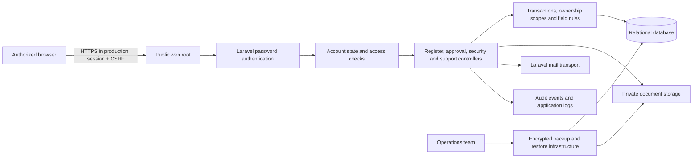
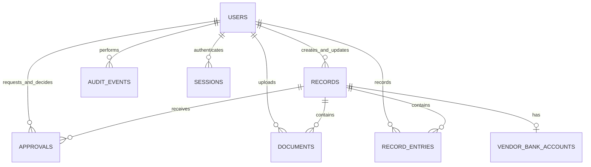

# SEND-AMS requirements, architecture, and acceptance

Current workflow update: the four roles, shared vehicle permissions, Trips-only driver navigation, reduced vehicle record, and username-based user editing are defined in [current access rules](ACCESS.md). Those rules supersede historical role and driver-licence requirements below.

## Scope and actors

The application supports SEND Ghana's vendor administration, vehicle movements, and asset custody across offices and departments. Procurement, inventory, requisitions, meeting rooms, budgeting, and travel remain future modules. All users have individual identities; accounts must not be shared.

Actors: Super Administrator, IT Administrator, Administrative Manager, Administrative Officer, Finance Officer, Driver, Staff, Auditor, and Management. Department and location are retained on records. Current broad administrative roles operate organization-wide; staff and drivers receive ownership-based record filtering. Department-specific administrator scopes and multi-role assignments are target requirements, not implemented claims.

## Functional requirements

| ID | Requirement | Acceptance criterion |
|---|---|---|
| IAM-01 | Individual authentication | Unauthenticated protected requests redirect to login; disabled users lose access |
| IAM-02 | Password sign-in | Direct sign-in without MFA; new/reset/changed passwords require at least eight characters |
| IAM-03 | Least privilege | Staff cannot create business records, export registers, or read unrelated records; IT cannot read operational records |
| IAM-04 | Account recovery | Valid one-time password reset token changes password and revokes database sessions; production mail transport must be configured |
| VEN-01 | Vendor register | Authorized officers create vendor identity/contact/classification records with generated unique references |
| VEN-02 | Independent approval | Creator cannot decide their own request; approved vendor becomes Active |
| VEN-03 | Bank changes | Proposed and approved banking values are encrypted; only authorized independent approval applies changes |
| VEH-01 | Vehicle registry | Duplicate normalized registration numbers are rejected; database unique key provides a second integrity boundary |
| TRP-01 | Driver eligibility | An active Driver account with administrator-recorded licence validity on departure is required |
| TRP-02 | Reservation integrity | Overlapping non-rejected/non-closed trips for a vehicle or driver are rejected |
| TRP-03 | Mileage | Opening mileage cannot undercut the vehicle odometer; closure cannot undercut opening mileage; closure calculates distance |
| AST-01 | Unique identity | Asset reference is generated once and cannot be edited |
| AST-02 | Custody | Available asset can be assigned; assigned asset can transfer; independent approval precedes recipient acknowledgement |
| AST-03 | Disposal | Independent approval sets Disposed; record and approval history remain stored |
| SHR-01 | Controlled changes | Pending edits preserve current values; independent approval applies changes; stale record versions are rejected |
| DOC-01 | Protected documents | Permitted file formats up to 10 MB go to private storage; downloads re-check record access |
| REP-01 | Exports | Authorized records only are exported; export is audited; formula-like text is neutralized in CSV |
| AUD-01 | Accountability | Login events, creations, operational entries, downloads, exports, and approval decisions record actor/time/subject |
| UX-01 | Usability | Desktop and 390-pixel mobile layouts render without page overflow; forms have associated labels and errors |

## Architecture and trust boundaries

Only `app/public` is a web root. Authentication, role checks, and record scopes precede operational queries. Browser rendering never establishes authorization. Private storage is not linked into public storage. The database and APP_KEY are separate security assets; both are needed to restore encrypted fields.

Local configuration uses SQLite; the default Laravel MySQL connection remains available for deployment. The current implementation stores shared register identity in `records`, with validated module fields in JSON. It is not the full normalized target schema from the brief. Before large-scale production use, promote searchable domain fields into dedicated normalized tables and add MySQL concurrency tests.

## Current database ERD

Every record has immutable reference, module, name, category, department, location, status, JSON details, version, creator, updater, and timestamps. Approvals retain action, proposed payload, requester, independent decision maker, decision reason, and timestamps. Bank payloads are encrypted; active bank details use Eloquent encrypted casts. Documents retain private path, original name, type, uploader, and expiry. Operational entries retain record, type, title, date, quantity, amount, notes, and due date.

## Role-permission matrix (current)

| Role | Operational read | Create / request | Approve | Export | Audit | Accounts |
|---|---|---|---|---|---|---|
| Super Administrator | All | Yes | Independent | Yes | Yes | All |
| IT Administrator | None | None | No | No | Yes | Provision Staff/Driver |
| Administrative Manager | All | Yes | Independent | Yes | Yes | No |
| Administrative Officer | All | Yes | No | Yes | No | No |
| Finance Officer | All authorized business registers | Banking request | No | Yes | No | No |
| Driver | Own trips/assigned vehicles | Own trips and trip entries | No | No | No | No |
| Staff | Own asset records | Acknowledge receipt | No | No | No | No |
| Auditor | All business registers | No | No | Yes | Yes | No |
| Management | All business registers | No | Independent non-bank decisions | Yes | No | No |

Banking views and requests are limited to Super Administrator, Administrative Manager and Finance; decisions currently require Super Administrator or Administrative Manager. Privileged account changes require password reauthentication. The creator cannot approve their own request even if they also hold approval authority.

## Workflows

1. Vendor: create → Pending review → independent approval → Active; rejection → Rejected.
2. Bank details: submit encrypted proposal → independent authorized review → approved encrypted active values; rejection leaves active values unchanged.
3. Trip: signed-in Driver opens with fixed identity (or Super Administrator selects an actual driver), Department/Project, From, Destination, departure and Mileage Before → Pending (amber) → original driver or Super Administrator records Mileage After and actual return → Completed (green), distance calculated and vehicle odometer updated. Return time defaults to entry time and is editable. Non-drivers cannot create trips unless they are Super Administrators; trips do not enter the independent approval queue.
4. Asset assignment: Available → assignment request → independent approval → Awaiting acknowledgement → recipient acknowledgement → Assigned.
5. Asset transfer: Assigned → transfer request → independent approval → Awaiting acknowledgement → new recipient acknowledgement → Assigned.
6. Asset disposal: Available or Assigned → disposal request → independent approval → Disposed; reference/history remain.
7. Record edit: collect proposed values and prior snapshot → independent review → apply on approval; rejection retains existing values.

## Confidentiality, integrity, and availability controls

| Objective | Implemented control | Operational / remaining dependency |
|---|---|---|
| Confidentiality | Authentication, eight-character minimum passwords, encrypted banking, record scopes, private downloads, CSP and no-store headers | HTTPS configuration, safe APP_KEY management, document classification and department scope refinement |
| Integrity | CSRF, validation, database constraints, transactions, lock-based workflow checks, independent decisions, version checks, audit events | MySQL load/concurrency verification and externally protected audit storage |
| Availability | Database migrations, Laravel job infrastructure and health endpoint | Supervised workers, scheduler, monitoring, encrypted backups, verified restore and recovery targets |

## Project structure

`app/app/Http/Controllers` contains account, security, register, record-edit and document/entry endpoints. `app/app/Services` contains access scopes and module field definitions. `app/app/Models` contains user, register and encrypted bank models. `app/database/migrations` defines schema. `app/resources/views` contains Blade pages. `app/public` contains the front controller and local UI assets. `app/tests/Feature` contains workflow and security acceptance tests. `app/storage/app/private` contains protected files.

## Phased delivery and release gates

1. Foundation: authentication, access checks, account provisioning, shared approvals and auditing. Gate: authentication/authorization/security tests pass.
2. Vendors: registration, approval, compliance, banking, contracts and evaluations. Gate: independent decisions and encrypted banking tests pass; complete remaining structured vendor functionality before production sign-off.
3. Fleet: vehicle/trip records, driver authorization, operational history. Gate: eligibility, conflicts and mileage tests pass; validate production MySQL locking and complete actual dispatch lifecycle.
4. Assets: registration, custody, transfer, acknowledgement, disposal and operational history. Gate: assignment/transfer/disposal transitions pass; finish tagging, valuation and structured stocktake reconciliation.
5. Hardening: deployment review, audit protection, backup/restore, monitoring and load/security tests. Gate: no critical findings; approved recovery and availability targets met in the intended hosting environment.

Performance, user-volume, availability, retention, RPO and RTO targets require SEND Ghana agreement and measured verification; none are implied by a local smoke test.
